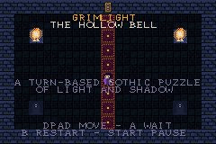
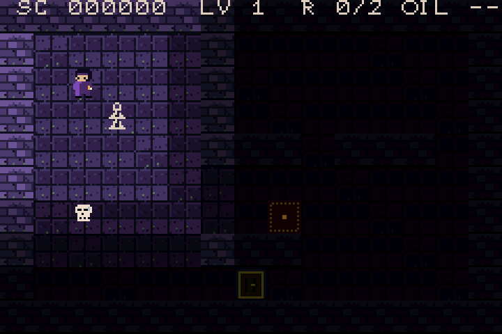
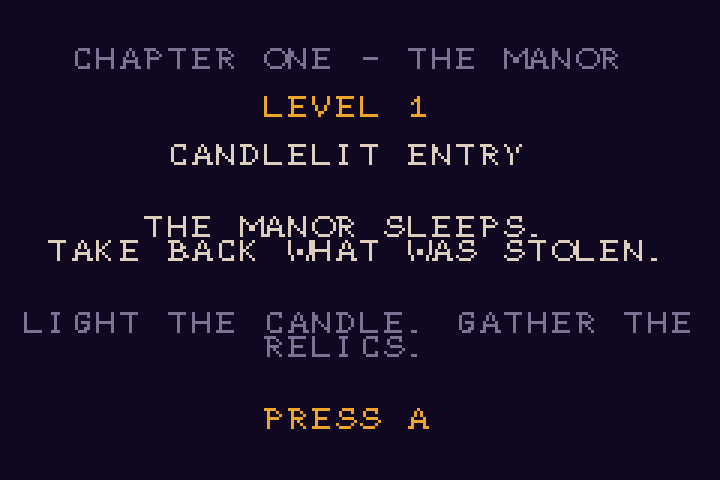
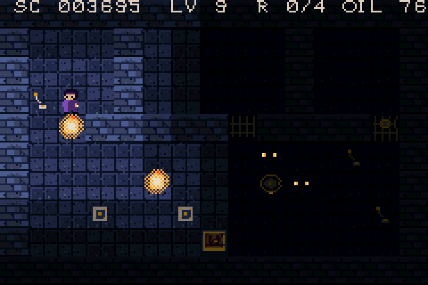
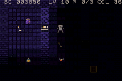
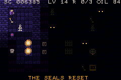
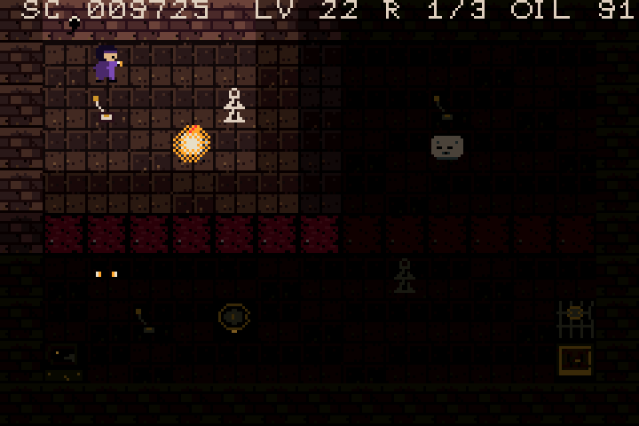
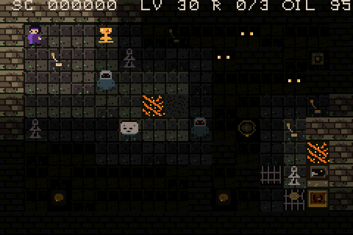

# GRIMLIGHT: The Hollow Bell

**A turn-based gothic puzzle of light and shadow for Game Boy Advance.**

On Halloween night, the Hollow Bell of Grimlight Manor tolls for the dead — and something has stolen the manor's soul relics. You are the last lantern-keeper. Cross the manor, the crypt, and the belfry, descend to the Deep Bell, then push deeper still — into the Ember Deep and the Molten Choir — recover every relic, ring the bell, and lay the haunting to rest.

## How it plays

Every step you take, the haunting takes one too.

- **Your lantern is your shield — and your life.** Wraiths drift toward you through the dark but cannot enter the light — and cannot be destroyed. Herd them out of your path, or put them to work: a wraith standing on a pressure plate holds it down just as a brazier does. But your oil burns down with every step: as it empties your light shrinks, and at zero the lantern dies and the room restarts.
- **Skeletons** patrol their routes, light or no light. Time them.
- **Gloomweavers** creep diagonally through the dark every turn. Only bright light freezes them — at the edge of your glow they keep coming, eyes first.
- **Push braziers** to move your safe ground, block a patrol, or hold pressure plates — some gates need two plates held at once.
- **Flip lever switches** to swap paired gates, light every candle to unseal a candle-locked door, and toll bell runes to freeze every enemy where it stands — or to break the web sealing a door.
- One vault is sealed by **four seal levers** that only turn in one true order. A wrong turn resets them all.
- **Wardens** (Chapter Five) hold a killing gaze down a whole row. Cross only behind a pushed slab or brazier — lava blocks their sight, acid does not.
- **Pushable bone slabs** become footing, shields, and doorstops — and a careless push can trap you into a restart.
- **Hazards each have their own rule:** a river takes a slab or a brazier; lava settles only under a slab (a brazier is consumed); acid dissolves a slab but holds a brazier.
- **Bell portals** (Chapter Six) ring you across the room to their twin, and **crumbling floors** bear you exactly once — plan the way back before you cross.
- **Passcodes:** every room's intro screen shows a 5-letter code. Press SELECT at the title screen and enter it to jump straight back to that room.
- Collect every relic in the room to unseal the door — then escape.

30 rooms across 6 chapters: the Manor, the Crypt, the Belfry, the Deep Bell, the Ember Deep (rust and ember-brown), and the Molten Choir (ash-grey, ember-orange, acid-green).

## Controls

- **D-pad** — move (one tile = one turn)
- **A** — wait a turn
- **B** — restart the room
- **START** — pause
- **SELECT** (at title) — passcode entry

## Play it

Download the ROM from the Releases page and open it in any Game Boy Advance emulator (mGBA recommended). Real hardware works too, via flash cart.

Stuck on a room, or want to revisit a favourite? Every room's passcode is listed in [CODES.md](CODES.md).

## Built with

Hand-written C direct to the GBA hardware — tiled Mode 0 backgrounds, sprite walk cycles, flickering flames and rising embers, a four-step light-falloff palette, and a PSG soundtrack of organ arpeggios, bell tolls, and wind. Every room is machine-verified solvable: a solver plays all 30 rooms end to end against the real game code before a build ships.
